# 🛡️ Atul Anand Singh
### **Senior DevSecOps Engineer | Cloud Security & SRE Platform Architect**
**5+ Years of Industry Experience in Cloud Infrastructure, Zero-Trust Architecture & Automated Security**

  
  
  
  

  <b>"Bridging Development, Security, and Cloud Scale • Shifting Security Left • Zero-Trust by Design"</b>

---

## 📌 Executive Summary & 5+ Years Experience Profile

Senior **DevSecOps & Cloud Security Architect** with **5+ years of production experience** designing, automating, and securing large-scale distributed cloud infrastructure across **AWS and hybrid Kubernetes environments**. Proven track record of spearheading **Shift-Left Application Security (AppSec)**, automating end-to-end GitOps CI/CD pipelines, and establishing enterprise **Zero-Trust Kubernetes Security (CKS/CKA)**.

- 🎯 **Domain Expertise:** DevSecOps Transformation, Cloud Security Architecture, Kubernetes Hardening, Software Supply Chain Security (SLSA/SBOM), GitOps & Infrastructure as Code (IaC).
- 🔒 **Security Governance:** Shift-Left SAST/DAST/SCA automation, Zero Secrets Leakage, Runtime Threat Detection, CIS Benchmarks, SOC2 Type II & ISO 27001 compliance readiness.
- ⚡ **Scale & Impact:** Hardened 50+ Kubernetes clusters, automated security checks across 200+ microservices, and reduced deployment cycle lead times by 65%.

---

## 🏆 Key Career Milestones & Production Impact

| Metric | Business & Engineering Impact |
| :--- | :--- |
| **99.99% Reliability** | Architected highly-resilient, multi-region AWS EKS infrastructures with zero-downtime rolling upgrades. |
| **100% Shift-Left** | Embedded automated security gates (Gitleaks, SonarQube, Trivy, Checkov) halting 100% of high-severity CVEs pre-merge. |
| **Zero Secret Leaks** | Implemented HashiCorp Vault dynamic credential injection, deprecating 100% of static production secrets. |
| **65% Lead-Time Cut** | Replaced fragmented deployment pipelines with declarative GitOps (ArgoCD), reducing release latency from days to minutes. |
| **CIS & Policy Compliance** | Standardized 100+ Terraform modules with automated policy-as-code linting and automated drift remediation. |

---

## 🔄 Enterprise DevSecOps Shift-Left Architecture

The architectural pipeline below represents the automated security ecosystem I have implemented across enterprise engineering teams:

```mermaid
flowchart LR
    subgraph DEV ["1. Development & Code"]
      A["💻 Developer Push"] --> B["🔍 Pre-Commit Hooks\n(Gitleaks / TruffleHog)"]
    end

    subgraph CI ["2. Automated CI & Shift-Left"]
      B --> C["⚙️ CI Pipeline\n(GitHub Actions / Jenkins)"]
      C --> D["📊 SAST & Code Quality\n(SonarQube / Semgrep)"]
      D --> E["📦 SCA & Dependencies\n(Trivy / Snyk)"]
      E --> F["🐳 Container Hardening\n& Image Sign (Cosign)"]
    end

    subgraph IAC ["3. IaC & Policy Gate"]
      F --> G["📜 IaC Security & Policy\n(Checkov / tfsec / OPA)"]
    end

    subgraph CD ["4. GitOps & Zero-Trust CD"]
      G --> H["☸️ GitOps Deployment\n(ArgoCD to AWS EKS)"]
      H --> I["⚡ DAST Active Scan\n(OWASP ZAP)"]
    end

    subgraph RUNTIME ["5. Runtime Defense & SIEM"]
      I --> J["🛡️ Runtime Behavioral Audit\n(Falco Kernel Engine)"]
      J --> K["📈 Continuous Telemetry\n(Prometheus / Grafana / Security Hub)"]
    end

    classDef dev fill:#1e293b,stroke:#3b82f6,stroke-width:2px,color:#fff;
    classDef sec fill:#0f172a,stroke:#ef4444,stroke-width:2px,color:#fff;
    classDef ops fill:#1e293b,stroke:#10b981,stroke-width:2px,color:#fff;

    class A,C dev;
    class B,D,E,G,I,J sec;
    class F,H,K ops;
```

---

## 🛠️ Comprehensive Technical Competency Matrix

<table>
  <tr>
    <th>Category</th>
    <th>Technologies, Tools & Frameworks</th>
  </tr>
  <tr>
    <td><b>Cloud Infrastructure</b></td>
    <td>
      
      
      
      
      
      
    </td>
  </tr>
  <tr>
    <td><b>Containers & Orchestration</b></td>
    <td>
      
      
      
      
      
      
    </td>
  </tr>
  <tr>
    <td><b>Shift-Left AppSec & SAST/DAST</b></td>
    <td>
      
      
      
      
      
      
    </td>
  </tr>
  <tr>
    <td><b>Infrastructure as Code (IaC) & Policy</b></td>
    <td>
      
      
      
      
      
      
      
    </td>
  </tr>
  <tr>
    <td><b>Secrets & Identity Management</b></td>
    <td>
      
      
      
      
    </td>
  </tr>
  <tr>
    <td><b>Runtime Security & Observability</b></td>
    <td>
      
      
      
      
      
    </td>
  </tr>
  <tr>
    <td><b>CI/CD & Scripting Automation</b></td>
    <td>
      
      
      
      
      
    </td>
  </tr>
</table>

---

## 🚀 Enterprise Projects & Architectural Case Studies

### 1. 🛡️ Enterprise-Grade DevSecOps Pipeline with SLSA Software Supply Chain Security
* **Problem:** Software release cycles were burdened by manual security approvals, late-stage vulnerability discovery, and unverified third-party dependencies.
* **Architecture & Solution:**
  - Architected a standardized **GitHub Actions & Jenkins** multi-branch CI/CD template deployed across 50+ enterprise services.
  - Implemented automated **Gitleaks** pre-commit hooks, **SonarQube** quality gates (80% test coverage & 0 Security Hotspots required).
  - Integrated **Trivy** filesystem and image scanning, automatically halting pipelines on CRITICAL/HIGH CVEs.
  - Digitally signed built container images using **Cosign** and generated Software Bill of Materials (SBOM) with **Syft**.
* **Impact:** Reduced release turnaround time by 65% while maintaining 100% compliance with SLSA Level 3 security frameworks.
* **Source & Architecture:** [devsecops-portfolio](https://github.com/singhatulanand33/devsecops-portfolio)

---

### 2. ☸️ Production Zero-Trust Kubernetes Hardening & Falco Runtime Threat Engine
* **Problem:** Kubernetes clusters lacked strict multi-tenant boundary isolation, permitted privileged containers, and lacked real-time kernel anomaly detection.
* **Architecture & Solution:**
  - Hardened multi-tenant **AWS EKS** clusters utilizing **OPA Gatekeeper** and **Kyverno** admission webhooks to disallow root user execution and enforce read-only root filesystems.
  - Enforced microsegmentation with **Calico CNI NetworkPolicies**, isolating namespace ingress/egress.
  - Deployed **Falco** with custom behavioral rule sets (detecting bash execution in production pods, sensitive directory access), with automated alerting webhooks to Slack and SIEM.
* **Impact:** Achieved 100% compliance on CIS Kubernetes Benchmark audits; prevented privilege escalation vectors cluster-wide.

---

### 3. 📜 Self-Healing Multi-Region AWS Cloud Infrastructure via Terraform & Checkov
* **Problem:** Cloud drift and manual provisioning led to configuration vulnerabilities and inconsistent security posture across staging and production.
* **Architecture & Solution:**
  - Designed modular, enterprise-grade **Terraform** blueprints covering multi-AZ VPC topologies, EKS node groups, RDS Multi-AZ, and Transit Gateways.
  - Configured remote state locking with S3 and DynamoDB with AWS KMS customer-managed keys (CMK).
  - Implemented continuous automated IaC policy scans using **Checkov** and **tfsec** in pull request validation pipelines.
* **Impact:** Eliminated manual cloud configuration errors; achieved 100% automated infrastructure reproducibility with zero configuration drift.

---

### 4. 🔑 Centralized Dynamic Secrets Architecture with HashiCorp Vault
* **Problem:** Hardcoded credentials and long-lived database passwords posed catastrophic exposure risks.
* **Architecture & Solution:**
  - Deployed a high-availability **HashiCorp Vault** cluster on Kubernetes with auto-unseal using AWS KMS.
  - Configured Vault Dynamic Secrets engine for on-the-fly, short-lived AWS IAM and PostgreSQL credentials with automatic 1-hour TTL revocation.
  - Injected credentials directly into pod memory via Vault Agent Sidecar Injector, completely eliminating plaintext credentials in source code and ConfigMaps.
* **Impact:** Eliminated 100% of static credentials across production microservices.

---

## 🎖️ Certifications & Professional Accreditations

| Credential | Issuing Body | Specialization Focus |
| :--- | :--- | :--- |
| **Certified Kubernetes Security Specialist (CKS)** | CNCF / Linux Foundation | Cluster Hardening, Threat Mitigation & Runtime Defense |
| **Certified Kubernetes Administrator (CKA)** | CNCF / Linux Foundation | Storage, Networking, Multi-Node Cluster Orchestration |
| **AWS Certified Solutions Architect – Associate** | Amazon Web Services | Highly Available, Scalable & Secure Multi-Tier Cloud Systems |
| **AWS Certified Security – Specialty** | Amazon Web Services | Cloud IAM, KMS, Security Hub, GuardDuty & Incident Defense |
| **HashiCorp Certified: Terraform Associate** | HashiCorp | Enterprise Infrastructure as Code & State Management |

---

## 📊 GitHub Analytics & Operational Metrics

  
  

  

---

## 📬 Connect & Collaborate

  
  
  
  

  <i>⭐ Always open to discussions on DevSecOps transformations, Cloud Security Architecture, and high-scale Platform Engineering. ⭐</i>

