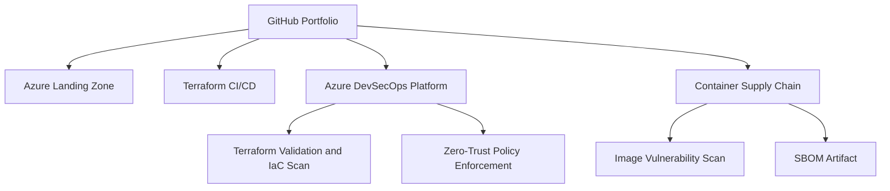

### 🔐 Senior DevSecOps Engineer | Microsoft Azure | Terraform | CI/CD

**Cloud Infrastructure · Automation · Security · Reliability**

---

## 👋 About Me

I am a **Senior DevSecOps Engineer with 5+ years of experience** across Azure cloud, CI/CD, and infrastructure automation. My focus is building repeatable infrastructure, improving delivery workflows, and bringing security checks earlier into the software delivery lifecycle (Shift-Left).

I work with **Microsoft Azure, Terraform, GitHub Actions, Azure DevOps Pipelines, Linux, Docker, scripting, and cloud security practices**. My portfolio documents hands-on learning and implementation work; each repository describes what is currently implemented versus planned.

📍 Open to relevant DevOps, DevSecOps, Azure Cloud, Platform Engineering, and Infrastructure as Code opportunities, including remote roles worldwide.

## 🧭 Portfolio Delivery Map

## 🧰 Technology Stack

| Domain | Skills and tools |
|---|---|
| ☁️ **Cloud & Networking** | Microsoft Azure, Virtual Networks, subnets, Network Security Groups, identity and access concepts, Azure Key Vault, Azure Monitor |
| 🏗️ **Infrastructure as Code** | Terraform, AzureRM provider, reusable modules, variables, state/backend concepts, plan/apply workflows |
| 🔄 **CI/CD & Automation** | GitHub Actions, Azure DevOps Pipelines, YAML, pipeline stages/jobs/steps, build and deployment workflows |
| 🔐 **DevSecOps** | Shift-left security concepts, secrets management, least privilege, Terraform validation, IaC scanning with Checkov, linting with TFLint |
| 📦 **Containers & Orchestration** | Docker, Docker Compose, Kubernetes manifests and deployment fundamentals |
| 🐧 **Systems & Scripting** | Linux, Bash, PowerShell, Git, Python fundamentals |
| 📊 **Operations mindset** | Troubleshooting, logging/monitoring concepts, change review, documentation, cost and security awareness |

## 🏅 Microsoft & Industry Certifications

- **AZ-104** — Microsoft Azure Administrator
- **AZ-400** — Designing and Implementing Microsoft DevOps Solutions
- **AZ-305** — Designing Microsoft Azure Infrastructure Solutions
- **Certified Kubernetes Security Specialist (CKS)** / **CKA**
- **HashiCorp Certified: Terraform Associate**

## 🚀 Featured Projects

### 1. 🔐 DevSecOps Platform & Live Portfolio
Production-grade DevSecOps platform and portfolio showcasing end-to-end automated security pipelines (SAST, SCA, container scanning, Cosign signing, and SBOM generation).

[**Explore DevSecOps Platform →**](https://github.com/singhatulanand33/devsecops-portfolio) · [**Live Demo Website →**](https://singhatulanand33.github.io/devsecops-portfolio/) · [**Pipeline Workflow →**](https://github.com/singhatulanand33/devsecops-portfolio/blob/main/.github/workflows/deploy.yml)

### 2. 🛡️ Azure DevSecOps Platform
Modular Terraform project with environment configuration, separate application and management network security groups, and a GitHub Actions workflow for formatting, validation, linting, and IaC scanning.

[**Explore Azure DevSecOps Platform →**](https://github.com/singhatulanand33/azure-devsecops-platform) · [**GitHub Actions runs →**](https://github.com/singhatulanand33/azure-devsecops-platform/actions)

### 3. 🏢 Azure Enterprise 3-Tier Architecture
Terraform portfolio project exploring Azure networking and selected application, data, security, and monitoring resources with strict NSG segmentation and private endpoints.

[**Explore 3-Tier Architecture →**](https://github.com/singhatulanand33/azure-enterprise-3-tier-architecture)

### 4. ☁️ Azure Production Landing Zone
Terraform project covering resource organization, virtual networking, subnets, NSGs, and centralized identity/security management with Key Vault and Monitor.

[**Explore Azure Landing Zone →**](https://github.com/singhatulanand33/azure-production-landing-zone)

### 5. 🔄 Azure Terraform CI/CD
Automated CI/CD workflows connecting Terraform with GitHub Actions and Azure using federated credentials (OIDC) and Checkov security scanning.

[**Explore Terraform CI/CD →**](https://github.com/singhatulanand33/azure-terraform-cicd)

### 6. 🐳 Secure Container Supply Chain & Dockerized DevOps
Build, scan with Trivy, sign with Cosign, and generate SBOM for container images using GitHub Actions automated workflows.

[**Explore Container Supply Chain →**](https://github.com/singhatulanand33/dockerized-application-devops)

## 🔒 How I Approach DevSecOps

- **Automate infrastructure:** keep cloud configuration version-controlled, repeatable, and reviewable.
- **Build quality gates:** format and validate Terraform, lint configuration, and scan Infrastructure as Code.
- **Protect credentials:** avoid hard-coded secrets and prefer managed identity or federated identity where supported.
- **Apply least privilege:** review access permissions and network exposure before deployment.
- **Make changes safely:** inspect Terraform plans, understand resource impact, and require review before sensitive changes.
- **Document honestly:** distinguish tested implementation from roadmap items and avoid claiming production readiness without evidence.

## 🎯 Current Focus

- Improving reusable Terraform modules and environment separation.
- Strengthening CI/CD pipeline security and Azure authentication patterns.
- Improving network segmentation and cloud security posture.
- Practising container and Kubernetes deployment workflows.
- Publishing clear project documentation and validation evidence.

## 📊 GitHub Analytics

  
  

  

## 🤝 Connect

I welcome conversations about Azure DevOps, DevSecOps, Terraform, CI/CD automation, and cloud infrastructure opportunities.

